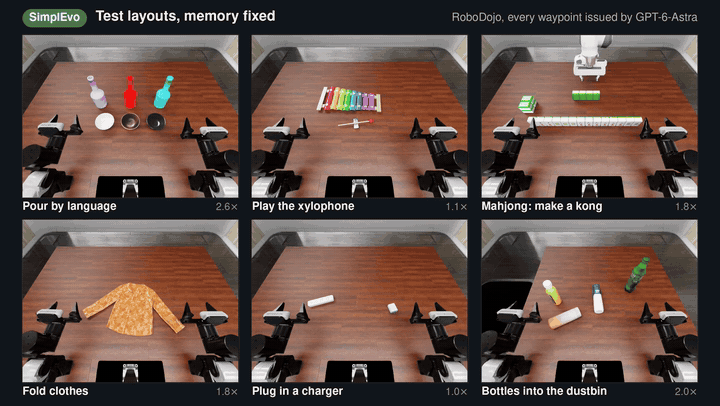
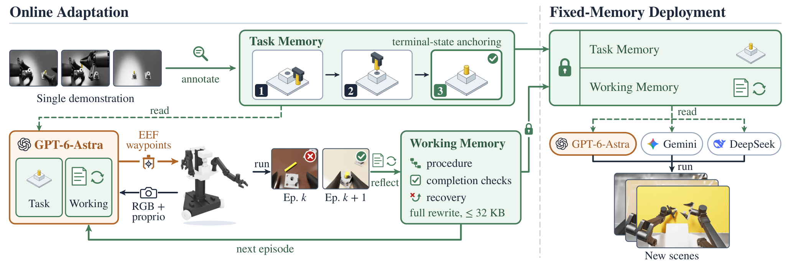
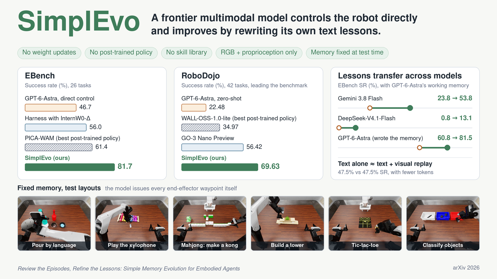

# SimplEvo

**Review the Episodes, Refine the Lessons: Simple Memory Evolution for Embodied Agents**

Yifei Yao, Yude Zou, Xing Gao, Guanbo Jiao, Yukai Wang, Jianming Ma, Weinan Zhang, Chunhua Shen

[Paper (arXiv:2611.11509)](https://arxiv.org/abs/2611.11509) | [Video, 3 min with narration](assets/simplevo_teaser.mp4)

[](assets/simplevo_teaser.mp4)

SimplEvo lets a multimodal LLM control a robot directly and improve from its own episodes without any weight
update. The model issues every end-effector command itself, sees only RGB images and the robot's measured state, and
keeps two text memories that it writes itself:

- **Task memory.** Before the first episode, an annotator instance of the model reviews one demonstration and
  writes the stages of the task in order and the visual state of the completed task. It is fixed during execution.
- **Working memory.** After every adaptation episode, the model reviews its own trajectory and the evaluator's
  outcome in one reflection turn and rewrites a bounded set of lessons: what worked, what failed and why.

After adaptation on training scenes the working memory is fixed and read, unchanged, in new scenes.



## Results in the paper



The benchmark results are success rates on test scenes, with both memories fixed.

- **EBench.** GPT-6-Astra under direct control rises from 46.7% to 81.7%. The best post-trained policy reaches
  61.4%.
- **RoboDojo.** SimplEvo reaches 69.63% with a score of 75.32, leading the benchmark. The same model, zero-shot, is
  at 22.48%.
- **Text is enough.** On four high-precision EBench tasks, adding replayed visual frames to the working memory gives
  the same success rate (47.5%) and costs more tokens.
- **Memory helps direct control most.** On the same four tasks, direct control rises from 15.0% to 47.5%, while a
  harness that calls the policy π0.5 moves from 22.5% to 25.0%.
- **Lessons hold in new scenes.** On the RoboDojo Generalization tasks, SimplEvo reaches 52.00% on standard scenes
  and 52.00% on randomized ones.
- **Lessons transfer across models.** Gemini 3.8 Flash reads the working memory of GPT-6-Astra as is and rises from
  23.8% to 53.8% on EBench, with no adaptation of its own.

## This repository

This repository is the benchmark-independent core of the method: the task formulation, the annotation step, and
the memory-improvement loop. It contains no benchmark adapter, no released memory and no experiment record, so the
numbers above are not reproduced by this code alone: they need an adapter for the benchmark and access to the model.

## Layout

| Part | Module | What it holds |
|---|---|---|
| Task formulation | `simplevo/task.py` | `TaskSpec`, `Embodiment`, the `Environment` interface, the information protocol, the first prompt |
| | `simplevo/control.py` | the action: chunks of absolute end-effector waypoints (`execute_eef`, `set_gripper`, `observe`) |
| Annotation | `simplevo/demonstration.py` | a recorded demonstration, kinematic segmentation, the read-only demonstration tools |
| | `simplevo/annotate.py` | the annotator prompt, the structured submission and its checks, rendering into a task memory |
| | `simplevo/task_memory.py` | the task memory and the `query_icl` tool |
| Memory improvement | `simplevo/working_memory.py` | the memory tools, the working-memory paragraph of the prompt, the reflection prompt |
| | `simplevo/chain.py` | the adaptation chain (view, commit) and the fixed memory (seal, validation) |
| | `simplevo/agent.py` | one episode with its reflection turn; `adapt` and `deploy` |
| Model | `simplevo/backends/` | the `ModelSession` contract, a Codex app-server backend, a scripted stand-in |
| Offline example | `simplevo/envs/toy.py` | a toy tabletop and a scripted stand-in for the model |

`docs/METHOD.md` maps the code to the method and lists the file formats. `docs/ADAPTER.md` explains how to connect
a benchmark.

## Quick start

```bash
pip install -e ".[test]"
pytest                                   # offline: no simulator, no model, no credentials
python -m simplevo toy --out runs/toy    # the whole loop on the toy tabletop
```

The `toy` command runs test scenes without a working memory, adapts on training scenes, fixes the working memory,
and runs the same test scenes again. A scripted stand-in plays the model, so the command shows the data flow
(prompts, tool calls, reflection, commits, the sealed memory) and nothing about model behaviour. Every episode
folder under `runs/toy` holds the prompt, each tool call with the observation the model received, and the
reflection record.

## Using it with a model and a benchmark

1. Implement `simplevo.task.Environment` for the benchmark (see `docs/ADAPTER.md`) and describe the task and robot
   in a JSON file.
2. Export one demonstration per task into the folder layout of `simplevo/demonstration.py`.
3. Run the three phases:

```bash
python -m simplevo annotate --demo demos/my_task --task my_task.json --out memory/my_task/task
python -m simplevo adapt  --env my_adapter:make_env --task my_task.json --scenes train_a train_b train_c \
    --task-memory memory/my_task/task --demo demos/my_task --chain memory/my_task/chain --out runs/my_task/train
python -m simplevo fix    --chain memory/my_task/chain --out memory/my_task/fixed
python -m simplevo deploy --env my_adapter:make_env --task my_task.json --scenes test_a test_b \
    --task-memory memory/my_task/task --demo demos/my_task --memory memory/my_task/fixed --out runs/my_task/test
```

The commands drive the model through the Codex CLI's app-server (`codex` must be installed and logged in). Another
model is connected by implementing `simplevo.backends.ModelSession`: a persistent conversation with image input
and tool calls whose results may contain images.

## Information protocol

The agent receives what a physical deployment provides: RGB images from the robot's cameras and proprioception.
An environment adapter must not return depth, camera parameters or object states, and the model is not told how
many steps an episode allows. During adaptation the only supervision is the terminal outcome of each episode. Test
scenes never write to the memory: `deploy` reads a sealed snapshot and checks its hashes after every episode.

## Citation

```bibtex
@article{yao2026simplevo,
  title   = {Review the Episodes, Refine the Lessons: Simple Memory Evolution for Embodied Agents},
  author  = {Yao, Yifei and Zou, Yude and Gao, Xing and Jiao, Guanbo and Wang, Yukai and Ma, Jianming and
             Zhang, Weinan and Shen, Chunhua},
  journal = {arXiv preprint arXiv:2611.11509},
  year    = {2026}
}
```

## License

MIT, see `LICENSE`.
