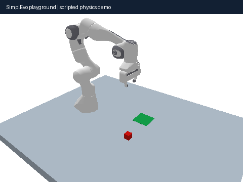

<h1 align="center">SimplEvo</h1>
<h2 align="center">Review the Episodes, Refine the Lessons:<br>Simple Memory Evolution for Embodied Agents</h2>

<p align="center">
  Yifei Yao<sup>1*</sup> &nbsp; Yude Zou<sup>1,2*</sup> &nbsp; Xing Gao<sup>1†</sup> &nbsp;
  Guanbo Jiao<sup>1,3</sup> &nbsp; Yukai Wang<sup>1</sup><br>
  Jianming Ma<sup>1,2</sup> &nbsp; Weinan Zhang<sup>1,2</sup> &nbsp; Chunhua Shen<sup>1,4</sup>
</p>
<p align="center">
  <sup>1</sup>Shanghai Artificial Intelligence Laboratory &nbsp;
  <sup>2</sup>Shanghai Jiao Tong University<br>
  <sup>3</sup>Fudan University &nbsp; <sup>4</sup>Zhejiang University<br>
  <sup>*</sup>Equal contribution &nbsp; <sup>†</sup>Corresponding author
</p>
<p align="center">
  <a href="https://arxiv.org/abs/2611.11509"></a>
  <a href="https://arxiv.org/pdf/2611.11509"></a>
  <a href="https://github.com/user-attachments/assets/c2f56b3a-01c5-4a82-ad18-9d945a67feef"></a>
</p>

https://github.com/user-attachments/assets/c2f56b3a-01c5-4a82-ad18-9d945a67feef

SimplEvo lets a multimodal LLM control a robot directly and improve from its own episodes without any weight
update. The model issues every end-effector command itself, sees only RGB images and the robot's measured state, and
keeps two text memories that it writes itself:

- **Task memory.** Before the first episode, an annotator instance of the model reviews one demonstration and
  writes the stages of the task in order and the visual state of the completed task. It is fixed during execution.
- **Working memory.** After every adaptation episode, the model reviews its own trajectory and the evaluator's
  outcome in one reflection turn and rewrites a bounded set of lessons: what worked, what failed and why.

After adaptation on training scenes the working memory is fixed and read, unchanged, in new scenes.


## Results in the paper


The benchmark results are success rates on test scenes, with both memories fixed.

- **EBench.** GPT-6-Astra under direct control rises from 46.7% to 81.7%. The best post-trained policy reaches
  61.4%.
- **RoboDojo.** SimplEvo reaches 69.63% with a score of 75.32, the top result on the benchmark. The same model,
  zero-shot, is at 22.48%.
- **Text is enough.** On four high-precision EBench tasks, adding replayed visual frames to the working memory gives
  the same success rate (47.5%) and costs more tokens.
- **Memory helps direct control most.** On the same four tasks, direct control rises from 15.0% to 47.5%, while a
  harness that calls the policy π0.5 moves from 22.5% to 25.0%.
- **Lessons hold in new scenes.** On the RoboDojo Generalization tasks, SimplEvo reaches 52.00% on standard scenes
  and 52.00% on randomized ones.
- **Lessons transfer across models.** Gemini 3.8 Flash reads the working memory of GPT-6-Astra as is and rises from
  23.8% to 53.8% on EBench, with no adaptation of its own.

## Configuration

Runtime hyperparameters live in [`simplevo/defaults.yaml`](simplevo/defaults.yaml), grouped by model,
episode, memory, demonstration, segmentation, annotation and toy settings. Copy it to customize a run,
or write a YAML file containing just the values you want to change:

```yaml
model:
  name: gpt-6-astra
  effort: high
memory:
  notes_limit: 32768
  reflection_calls: 12
  reflection_writes: 2
toy:
  train: 5
  test: 3
```

```bash
simplevo toy --config experiment.yaml --out runs/configured
simplevo adapt --config experiment.yaml --env my_adapter:make_env \
  --task task.json --scenes 0 1 2 --chain runs/chain --out runs/train
```

Precedence is **command-line flags → YAML → bundled defaults**. Each episode records its effective
settings in `policy/config.yaml`; annotation writes `config.yaml` next to its task memory. An existing
chain retains its carry mode and notes budget when reopened without a configuration file. When supplying
YAML for an existing chain, use the same carry mode and notes budget as its `chain.json`.

The Python API accepts the same configuration:

```python
from simplevo.config import load_config

config = load_config("experiment.yaml")
# Pass config=config to run_episode(), adapt(), deploy(), or annotate().
# For a new AdaptationChain, set carry=config["memory"]["carry"] and
# notes_limit=config["memory"]["notes_limit"].
```

Task instructions, cameras, arms and robot action limits remain in the task specification (`--task`).

## This repository

This repository implements the complete SimplEvo workflow: demonstration annotation, direct end-effector control,
episode reflection, working-memory adaptation, and deployment with a fixed memory. The `Environment` and
`ModelSession` interfaces connect the workflow to robot benchmarks and multimodal models. A toy tabletop example
demonstrates the full loop locally.

## Layout

| Part | Module | What it holds |
|---|---|---|
| Task formulation | `simplevo/task.py` | `TaskSpec`, `Embodiment`, the `Environment` interface, the information protocol, the first prompt |
| | `simplevo/control.py` | the action: chunks of absolute end-effector waypoints (`execute_eef`, `set_gripper`, `observe`) |
| Annotation | `simplevo/demonstration.py` | a recorded demonstration, kinematic segmentation, the read-only demonstration tools |
| | `simplevo/annotate.py` | the annotator prompt, the structured submission and its checks, rendering into a task memory |
| | `simplevo/task_memory.py` | the task memory and the `query_icl` tool |
| Memory improvement | `simplevo/working_memory.py` | the memory tools, the working-memory paragraph of the prompt, the reflection prompt |
| | `simplevo/chain.py` | the adaptation chain (view, commit) and the fixed memory (seal, validation) |
| | `simplevo/agent.py` | one episode with its reflection turn; `adapt` and `deploy` |
| Model | `simplevo/backends/` | the `ModelSession` contract, a Codex app-server backend, a scripted stand-in |
| Offline examples | `simplevo/envs/toy.py` | a toy tabletop and a scripted stand-in for the model |
| | `simplevo/envs/playground.py` | an optional headless Panda pick-and-place scene in PyBullet |
| Entry points | `simplevo/cli.py` | `toy`, `annotate`, `adapt`, `fix`, `deploy` and `baseline` |
| | `simplevo/config.py` | loading `defaults.yaml` and YAML overrides |

`docs/METHOD.md` maps the code to the method and lists the file formats. `docs/ADAPTER.md` explains how to connect
a benchmark.

## Quick start

Python 3.10 or newer is required. The offline example runs on CPU. From a source checkout on Linux or macOS:

```bash
git clone https://github.com/securityCFS/SimplEvo-base.git
cd SimplEvo-base
python3 -m venv .venv
source .venv/bin/activate
python -m pip install -e ".[test]"
python -m pytest -q                     # run the offline test suite
python -m simplevo toy --out runs/toy    # the whole loop on the toy tabletop
```

The `toy` command uses a scripted model to run the full workflow: evaluate the direct-control baseline, adapt on
training scenes, fix the working memory, and evaluate on the same test scenes. Each episode folder under
`runs/toy` records the prompt, tool calls, observations, and reflection.

With the default three training and three test scenes, the scripted example reports 0/3 successes before
adaptation and 3/3 after fixing its memory. Use a new `--out` directory for another run. For the Python API, run
`python examples/toy_adaptation.py runs/toy_api`.

Development checks, distribution checks and contribution guidance are in [CONTRIBUTING.md](CONTRIBUTING.md) and
the [release checklist](docs/RELEASE.md).

## Simulation playground



Try a Panda arm picking up a red cube and placing it on a green pad, with contact physics and two RGB cameras.
The optional playground runs headlessly on CPU. Its offline reference trajectory generates an animated preview,
a demonstration and a task file, without connecting to a model account:

```bash
# In a Python 3.11 environment:
python -m pip install -e ".[playground]"
python -m simplevo.envs.playground --scene 0 --out runs/panda
```

Open `runs/panda/preview.gif`. Use `simplevo.envs.playground:make_env` with the existing model commands to run
annotation, adaptation and deployment yourself. See the [playground guide](docs/PLAYGROUND.md) for the complete
commands and output files.

## Using it with a model and a benchmark

1. Implement `simplevo.task.Environment` for the benchmark (see `docs/ADAPTER.md`) and describe the task and robot
   in a JSON file.
2. Export one demonstration per task into the folder layout of `simplevo/demonstration.py`.
3. Annotate the demonstration, adapt the working memory, seal it, and deploy:

```bash
python -m simplevo annotate --demo demos/my_task --task my_task.json --out memory/my_task/task
python -m simplevo adapt  --env my_adapter:make_env --task my_task.json --scenes train_a train_b train_c \
    --task-memory memory/my_task/task --demo demos/my_task --chain memory/my_task/chain --out runs/my_task/train
python -m simplevo fix    --chain memory/my_task/chain --out memory/my_task/fixed
python -m simplevo deploy --env my_adapter:make_env --task my_task.json --scenes test_a test_b \
    --task-memory memory/my_task/task --demo demos/my_task --memory memory/my_task/fixed --out runs/my_task/test
```

### Direct-control baseline

`baseline` runs the same direct-control loop without working memory. The model issues every end-effector command
from the instruction and its observations; it has no memory tools, no reflection turn follows an episode, and
nothing carries over from one episode to the next. With `--task-memory` and `--demo` this is the direct-control
baseline of the paper (46.7% for GPT-6-Astra on EBench). Without them, the model receives the instruction alone.

To reproduce the paper's comparison between the baseline and SimplEvo on a benchmark:

1. **Connect the benchmark.** Implement an `Environment` adapter as described in `docs/ADAPTER.md`. It returns
   RGB views and measured proprioception only, and it enforces the benchmark's own step limit and success check.
   Benchmark adapters are not part of this repository.
2. **Write the task memory once per task.** Annotate one training demonstration. The baseline and SimplEvo read the
   same task memory, so the comparison isolates the working memory.

   ```bash
   python -m simplevo annotate --demo demos/my_task --task my_task.json --out memory/my_task/task
   ```

3. **Run the baseline on the test scenes.** The defaults follow the paper: `gpt-6-astra` at `high` reasoning
   effort, with chunks of up to six waypoints.

   ```bash
   python -m simplevo baseline --env my_adapter:make_env --task my_task.json --scenes test_a test_b \
       --task-memory memory/my_task/task --demo demos/my_task --out runs/my_task/baseline
   ```

4. **Run SimplEvo on the same test scenes.** Adapt on training scenes that are disjoint from the test scenes, fix
   the working memory and deploy it, as in the commands above.
5. **Compare per task.** Each episode keeps its outcome in `<out>/NNN/policy/result.json`. The paper averages the
   success rate and score within each task first and then over tasks:

   ```bash
   python examples/summarize_runs.py runs/*/baseline     # the baseline
   python examples/summarize_runs.py runs/*/test         # SimplEvo with the fixed working memory
   ```

Every test episode opens a new model session, and an existing episode folder is refused, so each scene is
attempted once and failed episodes stay in the count. For the raw variant without task memory, omit
`--task-memory` and `--demo` in step 3:

```bash
python -m simplevo baseline --env my_adapter:make_env --task my_task.json --scenes test_a test_b \
    --out runs/my_task/raw
```

Offline, `python -m simplevo toy --out runs/toy` runs the same comparison with a scripted model and reports it as
`test_without_working_memory` and `test_with_fixed_working_memory`.

### Model backend

The commands drive the model through the Codex CLI's app-server (`codex` must be installed and logged in). Another
model is connected by implementing `simplevo.backends.ModelSession`: a persistent conversation with image input
and tool calls whose results may contain images.

Select a model and reasoning effort available to your account with `--model` and `--effort`; the default is
`gpt-6-astra` with `high` effort. See the
[adapter guide](docs/ADAPTER.md#codex-backend) for the installed-CLI check and the tested protocol version.
Run one writer per adaptation chain. Resuming a chain retains its carry setting and appends each supplied scene
as a new episode. Pass the scenes you want to run next; see [CONTRIBUTING.md](CONTRIBUTING.md) for resuming a run.

## Agent sandbox

SimplEvo separates the model session from the host-side environment and memory tools. Each episode opens a
fresh, ephemeral Codex thread with a **read-only sandbox**, approvals disabled, and shell execution, web search,
sub-agents and automatic project-document loading turned off. The backend registers the task's tools explicitly;
the runner validates their arguments and dispatches robot actions, observations and memory operations.

The Python host executes these tools with its own permissions: it steps the environment, returns RGB images and
proprioception, and writes the model's lessons through bounded memory tools. This is how the model controls the
robot and evolves memory from a read-only session. After an adaptation episode, the reflection handler accepts
only memory tools; during deployment, each episode uses a private copy of the sealed memory.

The sandbox policy is set in [`CodexSession.start`](simplevo/backends/codex.py); tool dispatch and the reflection
boundary are in [`agent.py`](simplevo/agent.py). See the [adapter guide](docs/ADAPTER.md#sandbox-boundary) for the
scope of the session sandbox and the host adapter's responsibilities.

## Information protocol

The observation interface consists of RGB images from the robot's cameras and measured proprioception. The
environment manages its step budget internally. During adaptation, each episode's terminal outcome supervises
reflection. During deployment, every episode reads the same sealed memory snapshot, whose hashes are checked
after each episode.

## Citation

```bibtex
@article{yao2026simplevo,
  title   = {Review the Episodes, Refine the Lessons: Simple Memory Evolution for Embodied Agents},
  author  = {Yao, Yifei and Zou, Yude and Gao, Xing and Jiao, Guanbo and Wang, Yukai and Ma, Jianming and
             Zhang, Weinan and Shen, Chunhua},
  journal = {arXiv preprint arXiv:2611.11509},
  year    = {2026}
}
```

## License

MIT, see `LICENSE`.
